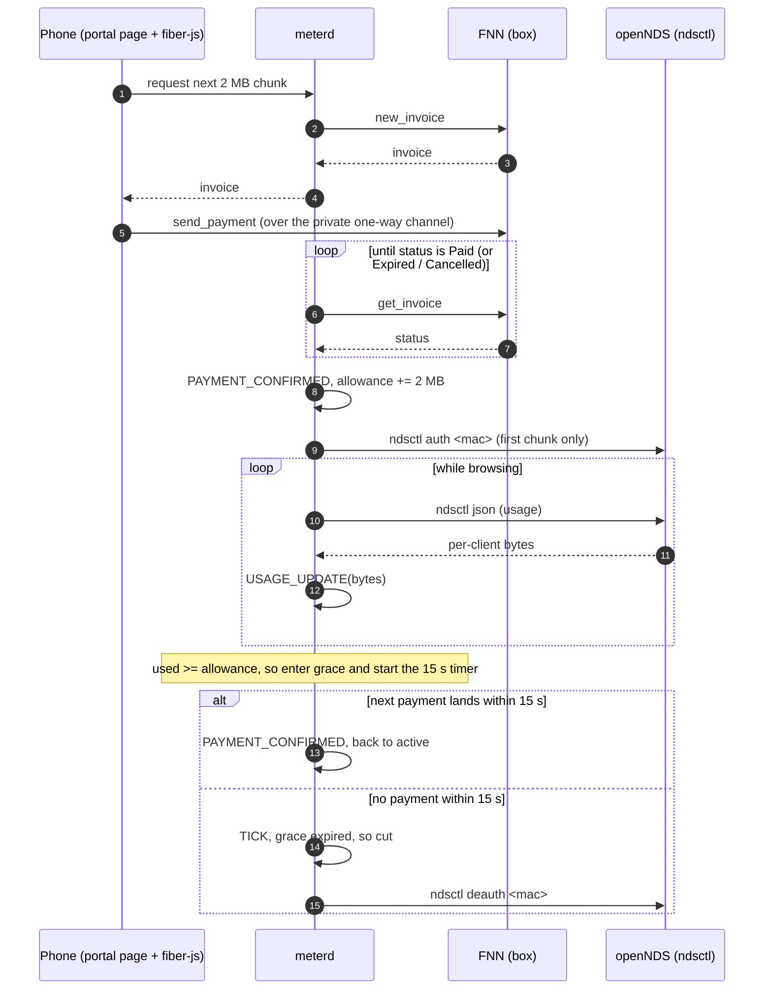

# Architecture

Status: week 0. This document describes the planned design. Nothing here is implemented except the `meterd` state-machine skeleton. Items marked `TODO(verify)` have not been checked against the Fiber, fiber-js or openNDS docs.

## Components

| Component | Runs on | Role |
|-----------|---------|------|
| **Box** | Linux laptop or Raspberry Pi | Hosts the Wi-Fi access point and every server-side component below. Has an uplink to the internet. |
| **openNDS + FAS** | Box | openNDS is the captive portal. It holds new clients in the walled garden and redirects them to the FAS (forwarding auth service), which serves the portal page. Access is granted and revoked with `ndsctl auth <mac>` / `ndsctl deauth <mac>`. Per-client state comes from `ndsctl json`. |
| **FNN** | Box | Native Fiber Network Node on CKB testnet. It issues invoices (`new_invoice`), reports their status (`get_invoice`), and holds the box's side of each user channel. |
| **meterd** | Box | TypeScript daemon. It owns one meter session per device: it creates an invoice per 2 MB chunk, polls for `Paid`, tracks allowance against usage, and calls `ndsctl` to grant or cut access. The core is a pure state machine (`meterd/src/meter.ts`) with I/O kept in thin adapters (`fnn.ts`, `ndsctl.ts`). |
| **Browser client** | User's phone | The portal page. It runs the official Fiber WASM / fiber-js node, calls `connect_peer` to the box's FNN, `open_channel` with `public: false, one_way: true`, and then `send_payment` for each chunk invoice. Not in this repo yet. |
| **Walled garden** | openNDS config | The set of destinations an unauthenticated client may reach. It must include the portal/FAS, the `meterd` HTTP endpoint, and the box FNN's peer endpoint. It probably also needs a CKB testnet RPC endpoint so the browser node can fund and watch the channel. `TODO(verify)`: exact endpoints, and whether fiber-js needs a WebSocket listener on FNN. |

### meterd session states

```
unpaid --PAYMENT_CONFIRMED--> active --USAGE_UPDATE(used >= allowance)--> grace
grace  --PAYMENT_CONFIRMED--> active
grace  --TICK(now - graceStart >= 15 s)--> cut     (not implemented yet; the failing test covers it)
```

- `unpaid`: no allowance yet. The device is in the walled garden only.
- `active`: usage is below the paid allowance.
- `grace`: usage has reached the allowance. A payment has up to `GRACE_MS = 15000` to land.
- `cut`: `meterd` has run (or will run) `ndsctl deauth <mac>`. Terminal for now. Whether a cut device can pay its way back in on the same session is decided in week 1.

Each chunk is `CHUNK_BYTES = 2 * 1024 * 1024`.

## One 2 MB chunk



## Failure scenarios

H2 requires every one of these to end with the device cut within 15 s of exhausting its allowance, across 3 runs each. None has been tested yet.

| # | Scenario | What should happen |
|---|----------|--------------------|
| 1 | **Tab closed.** The user closes the portal tab, so the in-browser node stops. | No more payments arrive. Grace expires, then deauth. |
| 2 | **Screen locked.** The phone locks and the browser throttles or suspends the page. | Same as 1, unless payments keep flowing. Records whether a locked phone can keep paying. |
| 3 | **Box uplink dropped.** The box loses its internet uplink. | Payments over the channel may still settle, because the channel is direct between phone and box. Record what happens to the meter and the user's traffic. |
| 4 | **Box rebooted.** The box restarts mid-session. | `meterd` session state is lost. After restart, no device may stay authenticated without a fresh payment. `TODO(verify)`: whether openNDS clears clients on restart. |
| 5 | **User stops paying.** The page stays open but payments stop. | Grace expires, then deauth. |
| 6 | **User channel empty.** The user's side of the channel runs out of funds. | `send_payment` fails on the phone. Grace expires, then deauth. The page should tell the user why. |

## Logging schema

`meterd` writes append-only JSON lines, one object per line, to a local file. Lines are never rewritten. These logs are the evidence for H1–H4.

| Field | Type | Notes |
|-------|------|-------|
| `ts` | string | ISO 8601 time of the log line. |
| `event` | string | `invoice_created`, `invoice_paid`, `invoice_expired`, `usage`, `grace_started`, `cut`. |
| `device_id` | string | `sha256(per-box salt + MAC)`, hex. The raw MAC is never logged. |
| `session_id` | string | Random ID per meter session. |
| `invoice` | string | The encoded invoice string returned by `new_invoice`. |
| `payment_hash` | string | Hex. |
| `preimage` | string \| null | Hex. Written only after the invoice is `Paid`. This is testnet, and the field exists so settlement can be audited. |
| `amount_shannons` | string | Invoice amount. `TODO(verify)`: unit and encoding as FNN reports them. |
| `t_invoice_created_ms` | number | Epoch ms when `new_invoice` returned. |
| `t_paid_seen_ms` | number \| null | Epoch ms when `get_invoice` first returned `Paid`. Settle latency for H1 is `t_paid_seen_ms - t_invoice_created_ms`, measured on the box. |
| `bytes_used` | number | Cumulative bytes for the session at the time of the line. |
| `allowance_bytes` | number | Cumulative paid allowance at the time of the line. |
| `cutoff_reason` | string \| null | Set only on `cut` lines. For example `grace_expired`. |

Example line (the shape only, not real data):

```json
{"ts":"…","event":"invoice_paid","device_id":"…","session_id":"…","invoice":"…","payment_hash":"0x…","preimage":"0x…","amount_shannons":"…","t_invoice_created_ms":0,"t_paid_seen_ms":0,"bytes_used":0,"allowance_bytes":2097152,"cutoff_reason":null}
```

## FNN RPC methods used

Only these method names are used anywhere in this project: `new_invoice`, `get_invoice`, `cancel_invoice`, `send_payment`, `get_payment`, `connect_peer`, `open_channel`, `list_channels`, `node_info`. `meterd` itself only needs `new_invoice` and `get_invoice` (plus possibly `cancel_invoice` for abandoned chunks). The rest are called by the browser client or used for operations and debugging. Exact parameter and result shapes are `TODO(verify)` in `meterd/src/fnn.ts`.
