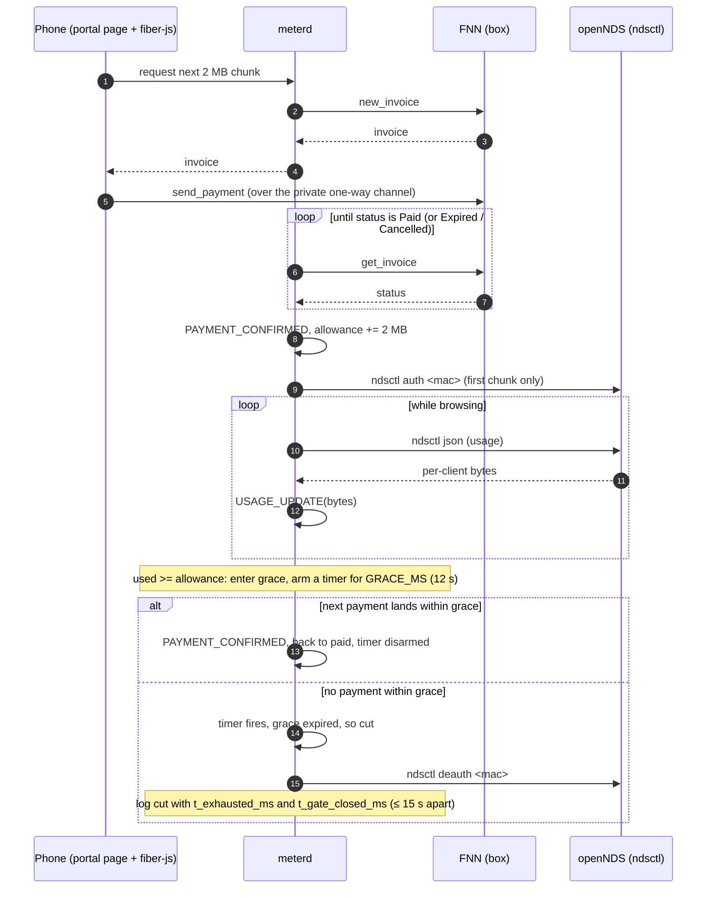

# Architecture

Status: week 2. Implemented and tested: the `meterd` state machine and meter loop, and the public web MVP (sessions API, metered gateway, dashboard, the Meter and Board pages; see "Public web MVP"). Still planned: everything on the hotspot box (openNDS). Items marked `TODO(verify)` have not been checked against the Fiber, fiber-js or openNDS docs, or measured.

## Components

| Component | Runs on | Role |
|-----------|---------|------|
| **Box** | Linux laptop or Raspberry Pi | Hosts the Wi-Fi access point and every server-side component below. Has an uplink to the internet. |
| **openNDS + FAS** | Box | openNDS is the captive portal. It holds new clients in the walled garden and redirects them to the FAS (forwarding auth service), which serves the portal page. Access is granted and revoked with `ndsctl auth <mac>` / `ndsctl deauth <mac>`. Per-client state comes from `ndsctl json`. |
| **FNN** | Box | Native Fiber Network Node on CKB testnet. It issues invoices (`new_invoice`), reports their status (`get_invoice`), and holds the box's side of each user channel. |
| **meterd** | Box | TypeScript daemon. It owns one meter session per device: it creates an invoice per 2 MB chunk, polls for `Paid`, tracks allowance against usage, and calls `ndsctl` to grant or cut access. The core is a pure state machine (`meterd/src/meter.ts`) with I/O kept in thin adapters (`fnn.ts`, `ndsctl.ts`). |
| **Browser client** | User's phone or browser | The portal page (hotspot) or demo page (web MVP). It runs the official Fiber WASM / fiber-js node, calls `connect_peer` to the box's FNN, `open_channel` with `public: false, one_way: true`, and then `send_payment` for each chunk invoice, one at a time. The node and the pages are in `web/`. |
| **Public server** | VPS | The web MVP: the same FNN and meterd, with Caddy for TLS (`wss://fiber.<host>` to FNN's P2P port, `https://<host>` for the page, `/api` and `/gw` to meterd on localhost). See "Public web MVP". |
| **Walled garden** | openNDS config | The set of destinations an unauthenticated client may reach. It must include the portal/FAS, the `meterd` HTTP endpoint, and the box FNN's peer endpoint. It probably also needs a CKB testnet RPC endpoint so the browser node can fund and watch the channel. fiber-js dials FNN over wss only: a TLS proxy in front of FNN's P2P port, which accepts WebSocket on the same port (verified on the public server, see FIBER_NOTES.md "Public wss endpoint"). The page also needs `https://testnet.ckbapp.dev/` (CORS allows any origin). `TODO(verify)`: the exact walled-garden entries on the box. The box needs its own hostname and certificate (see "openNDS facts"). |

### openNDS facts (checked 2026-11-11, openNDS v11.0.0)

From the docs (opennds.readthedocs.io, stable) and, where the docs are silent, the source at tag `v11.0.0` (`9477b22`):

- **Install.** Generic Linux is supported by compiling in place, with libmicrohttpd and nftables as dependencies. There is no Debian/Ubuntu package. Config is UCI-style at `/etc/config/opennds`; v11 requires named sections.
- **Commands.**
  - `ndsctl auth|deauth <mac|ip|token>`. Source usage: `auth … sessiontimeout uploadrate downloadrate uploadquota downloadquota customstring`.
  - Exit 0 on success, 1 otherwise (source).
  - The control socket is owner-only, so meterd must run as the same user as openNDS (root).
  - ndsctl state does not survive an openNDS restart.
- **Usage.**
  - `ndsctl json <mac>` prints `download_this_session` and `upload_this_session` in **KiB** (bytes / 1024), as strings (`src/util.c`, `ndsctl_json_client`).
  - It calls `iptables_fw_counters_update()` before printing, so every call reads the nftables counters fresh. meterd polls it; per-device iptables counters are not needed.
- **Portal and walled garden.**
  - A local FAS can't use port 80.
  - Walled garden by IP: `list preauthenticated_users`. By FQDN (TCP only, needs dnsmasq with nftset): `walledgarden_fqdn_list`. Box services: `list users_to_router`.
  - openNDS has its own `uploadquota`/`downloadquota`, enforced every `checkinterval` (default 15 s). meterd does not use them; it cuts with `ndsctl deauth` itself.
- **HTTPS is required** (FIBER_NOTES F-007). fiber-js only runs on a secure, cross-origin-isolated page. So the portal and the box's wss endpoint need a trusted certificate for a hostname that the box's DNS resolves to its LAN address.

### meterd session states

```
idle             --INVOICE_ISSUED-->                       awaiting_payment
awaiting_payment --INVOICE_CLOSED (last pending)-->        idle
awaiting_payment --PAYMENT_CONFIRMED-->                    paid
paid             --USAGE_UPDATE(used >= allowance)-->      grace
grace            --PAYMENT_CONFIRMED-->                    paid
grace            --TICK(now - graceStart >= GRACE_MS)-->   cut
```

- `idle`: no allowance and no invoice outstanding. The device is in the walled garden only.
- `awaiting_payment`: the first invoice has been issued but not paid. Still walled off.
- `paid`: usage is below the paid allowance. Once half a chunk (1 MB) is left, meterd issues the next invoice early, so a device that keeps paying never reaches grace. (The web gateway uses ~3 s of data at its pacing rate instead; see "Public web MVP".)
- `grace`: usage has reached the allowance. A payment has up to `GRACE_MS = 12000` to land (see "Cutoff budget").
- `cut`: the gate is closed (`ndsctl deauth <mac>` on the box). Terminal: a payment that lands late is ignored, and a returning device starts a new session.

A payment only counts if its payment hash belongs to an invoice meterd issued for that device.

### Cutoff budget

The proposal promises that access closes within 15 s once payment stops. meterd treats that as an end-to-end deadline, `CUTOFF_DEADLINE_MS = 15000`, measured from `t_exhausted_ms` (the usage reading that shows the allowance used up) to `t_gate_closed_ms` (when `ndsctl deauth` or the gateway close has returned). Both are on every `cut` log line, and H2 is computed from them.

| Part of the 15 s | Budget | How it is kept |
|---|---|---|
| Grace: time for a late payment to land | 12 s (`GRACE_MS`) | |
| Detecting that grace ran out | ≈ 0 | A timer is armed for the exact deadline when grace starts. The periodic `tick()` is only a backstop. The cut never waits on an FNN call. |
| Closing the gate | ≤ 1 s | To be measured on the box in the week-3 failure lab. |
| Margin | ≈ 2 s | |

meterd fails closed. If closing the gate fails, it logs a `gate_close_failed` line for each attempt and retries, starting at 500 ms and doubling to a 5 s cap, until the close succeeds. The `cut` line is written only then, so a slow or failed close shows up in H2 and is never hidden. If the failure lab measures more than this for detection plus closing, `GRACE_MS` comes down, not the deadline. Usage that arrives late from `ndsctl json` polling makes the device overshoot its allowance a little. It does not move the deadline, because the clock starts from the reading that shows exhaustion.

Each chunk is `CHUNK_BYTES = 2 * 1024 * 1024`.

### Public web MVP

The same meter, gating an HTTP gateway instead of Wi-Fi (`meterd/src/server.ts`, `sessions.ts`, `http-gate.ts`, `dashboard.ts`; run by `src/main.ts`).

- **Sessions.**
  - The page sends `POST /api/sessions {pubkey}` with its browser node's pubkey and gets back a random token.
  - The token keys the gate and the API, and is never logged.
  - `device_id` is hashed from the pubkey, so one browser's sessions count as one device across visits (H4).
  - The page then calls `POST /api/sessions/:token/chunk` for the invoice to pay; the response includes its `payment_hash`.
- **Gateway.**
  - `GET /gw/:token/(files|video)/:name` serves only MeterNet's own content in `CONTENT_DIR`: random test files, and a synthetic test video as HLS in ~2 MB segments. It is not a proxy.
  - Every byte written counts as usage.
  - **It never sends past the paid allowance.** At the limit a response waits, and the meter is in grace. It resumes when the next payment lands; if none lands, the grace deadline cuts the session, which also destroys any response still open. Measured: 0 unpaid bytes across the gateway runs in `evidence/week-2/`. The hotspot gate can't hold traffic like this, so it can overshoot a little.
- **Pacing.**
  - Each session is paced at 256 KiB/s (~2 Mbit/s), shared across its parallel requests.
  - Pacing faster than the visitor's link fills Caddy and kernel buffers: ~10 MiB counted but not yet delivered, measured on a 0.31 MiB/s link. Those bytes are already counted and paid, and they keep arriving long after the visitor stops paying.
- **Prefetch.**
  - The next invoice is issued with ~3 s of data left (`prefetchBytes`: 768 KiB at 256 KiB/s, between 512 KiB and one chunk). That covers the 1.0–2.3 s payment round trip measured from Lagos.
  - With 1 MB at 1 MiB/s, paying sessions stalled 0.4–1 s at almost every chunk.
- **What a visitor sees when they stop paying:** the data they have already paid for (up to ~2.75 MiB) keeps arriving, then stops. Measured 10.4–10.8 s after the last payment in the final runs. meterd then cuts the session 12 s after the allowance ran out, and the gateway answers 402.
- **Limits** (env, defaults in `sessions.ts`):
  - 100 MB per session;
  - 3 open sessions and 10 new sessions per minute per client address (the `X-Forwarded-For` entry Caddy appends; a spoofed one doesn't help);
  - 50 sessions in total;
  - idle sessions end after 10 minutes, with a `session_ended` line.
- **Dashboard.**
  - `GET /api/dashboard` (summaries) and `GET /api/dashboard/events` (live, server-sent events) are built from the same log lines meterd writes to disk.
  - They expose hashed device IDs, session IDs, payment hashes, bytes and cutoffs. No tokens, IP addresses, invoices or preimages: preimages are in the published logs.
- **Logs.** One JSONL file per UTC day (`web-YYYY-MM-DD.jsonl`), which is the daily export. On start, meterd replays them into the dashboard.
- **Session status for the page.** In grace, `cut_due_in_ms` (meterd's own deadline, for the countdown). Once cut, `cut.cutoff_ms` and whether it was within 15 s.
- **Feedback.**
  - `POST /api/feedback` takes three answers and an optional comment: how clear it was, how smooth it was (1–5 each), and whether they would use it (yes/maybe/no).
  - It is stored in `feedback-YYYY-MM-DD.jsonl` with the session ID and no IP address, pubkey or token. Five per address per minute.
  - It feeds the report's user-feedback summary.
- **Pages** (`web/public`, built from `web/src` with esbuild):
  - **the Meter** (`index.html`): boarding (wallet, test CKB, channel), the ride (video or download), stop paying, the cut, feedback;
  - **the Board** (`dashboard.html`): totals, sessions and a live tape;
  - `spike.html`: the bare connection test.
  - The page shell is ~17 KB; fiber-js (~15 MB) and hls.js load after it. Fonts are self-hosted (OFL), so the same pages can run inside the hotspot's walled garden.

## One 2 MB chunk



## Failure scenarios

H2 requires every one of these to end with `t_gate_closed_ms - t_exhausted_ms` ≤ 15 s, across 3 runs each. None has been tested yet.

| # | Scenario | What should happen |
|---|----------|--------------------|
| 1 | **Tab closed.** The user closes the portal tab, so the in-browser node stops. | No more payments arrive. Grace expires, then deauth. |
| 2 | **Screen locked.** The phone locks and the browser throttles or suspends the page. | Same as 1, unless payments keep flowing. Records whether a locked phone can keep paying. |
| 3 | **Box uplink dropped.** The box loses its internet uplink. | Payments over the channel may still settle, because the channel is direct between phone and box. Record what happens to the meter and the user's traffic. |
| 4 | **Box rebooted.** The box restarts mid-session. | `meterd` session state is lost. After restart, no device may stay authenticated without a fresh payment. `TODO(verify)`: whether openNDS clears clients on restart. |
| 5 | **User stops paying.** The page stays open but payments stop. | Grace expires, then deauth. |
| 6 | **User channel empty.** The user's side of the channel runs out of funds. | `send_payment` fails on the phone. Grace expires, then deauth. The page should tell the user why. |

## Logging schema

`meterd` writes append-only JSON lines, one object per line, to a local file. Lines are never rewritten. These logs are the evidence for H1–H4.

| Field | Type | Notes |
|-------|------|-------|
| `ts` | string | ISO 8601 time of the log line. |
| `event` | string | `invoice_created`, `invoice_paid`, `invoice_expired`, `invoice_cancelled`, `gate_opened`, `grace_started`, `gate_close_failed`, `cut`, `session_ended`. |
| `device_id` | string | `sha256(per-box salt + MAC)`, hex. The raw MAC is never logged. |
| `session_id` | string | Random ID per meter session. |
| `invoice` | string | The encoded invoice string returned by `new_invoice`. |
| `payment_hash` | string | Hex. |
| `preimage` | string \| null | Hex. meterd generates it and passes it to `new_invoice`, and writes it only on the `invoice_paid` line. This is testnet, and the field exists so settlement can be audited. |
| `hash_algorithm` | string \| null | `sha256` on invoice lines. meterd sets `hash_algorithm: "sha256"` on `new_invoice`, so `payment_hash == sha256(preimage)` can be checked with any tool. |
| `amount_shannons` | string | Invoice amount in shannons, as a decimal string (sent to FNN as hex). |
| `t_invoice_created_ms` | number | Epoch ms when `new_invoice` returned. |
| `t_paid_seen_ms` | number \| null | Epoch ms when `get_invoice` first returned `Paid`. Settle latency for H1 is `t_paid_seen_ms - t_invoice_created_ms`, measured on the box. |
| `bytes_used` | number | Cumulative bytes for the session at the time of the line. |
| `allowance_bytes` | number | Cumulative paid allowance at the time of the line. |
| `t_exhausted_ms` | number \| null | On `grace_started` and `cut` lines: epoch ms of the usage reading that showed the allowance used up. |
| `t_gate_closed_ms` | number \| null | On `cut` and `session_ended` lines: epoch ms when the gate close succeeded. H2 is `t_gate_closed_ms - t_exhausted_ms` ≤ 15000 on `cut` lines. |
| `cutoff_reason` | string \| null | On `cut` lines: why the device was cut, e.g. `grace_expired`. On `session_ended` lines (a session closed without being cut): `idle` or `shutdown`. Only `cut` lines count for H2. |
| `error` | string \| null | Set only on `gate_close_failed` lines: what the gate (`ndsctl deauth` or the gateway) reported. |

Example line (the shape only, not real data):

```json
{"ts":"…","event":"invoice_paid","device_id":"…","session_id":"…","invoice":"…","payment_hash":"0x…","preimage":"0x…","amount_shannons":"…","t_invoice_created_ms":0,"t_paid_seen_ms":0,"t_exhausted_ms":null,"t_gate_closed_ms":null,"bytes_used":0,"allowance_bytes":2097152,"cutoff_reason":null}
```

## FNN RPC methods used

Only these method names are used anywhere in this project: `new_invoice`, `get_invoice`, `cancel_invoice`, `send_payment`, `get_payment`, `connect_peer`, `open_channel`, `list_channels`, `node_info`. `meterd` itself only needs `new_invoice` and `get_invoice` (plus possibly `cancel_invoice` for abandoned chunks). The rest are called by the browser client or used for operations and debugging. Exact parameter and result shapes are `TODO(verify)` in `meterd/src/fnn.ts`.
